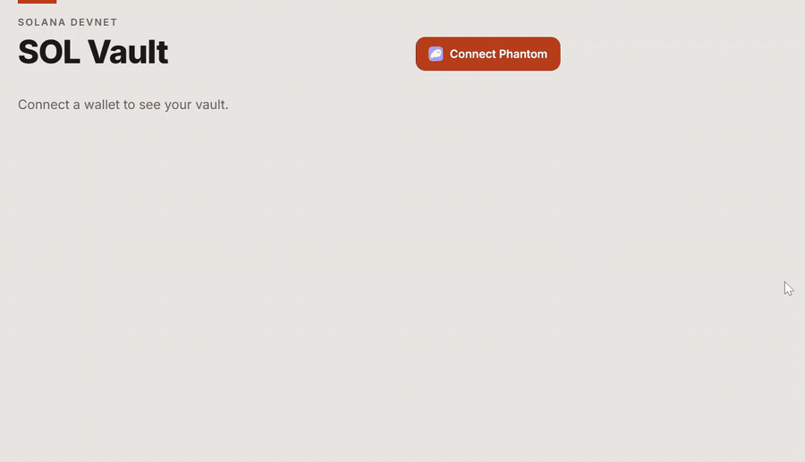

# Time-locked SOL Vault on Solana (Anchor + Rust)

A vault that holds SOL until a date you choose. The owner creates it with an unlock time, deposits SOL, can only withdraw after that time, and can push the date later but never earlier. Withdrawing empties the vault and closes its state account, so the rent comes back too. Built with **Anchor 1.2.2** and **Rust**, tested with **LiteSVM** (including a fake clock), deployed to **devnet**, and used from a small **React + Vite** front end with a **Codama**-generated client and **@solana/kit**.



**Full video tutorial on YouTube (21 min):** https://youtu.be/4R_oKhJVnqg

---

## What it does

| Instruction   | What happens on-chain |
|---------------|-----------------------|
| `initialize`  | Creates the vault state at a PDA derived from the owner's wallet and stores the unlock time. Fails if the time is not in the future. |
| `deposit`     | Moves SOL from the owner's wallet to the vault with a CPI to the System Program. Emits a `Deposited` event. |
| `withdraw`    | Only after the unlock time: sends all the SOL back to the owner, signed by the vault PDA, and closes the state account. Emits a `Withdrawn` event. |
| `extend_lock` | Moves the unlock time later. A new time that is not later than the current one fails. |

Program ID on devnet: `DhWRSVhphtMsyNAQjnQXc2FWaq4W2fnLJnn2v4sXMzRK`

## How it works: who can move the SOL?

There are two accounts per owner, both PDAs (addresses with no private key):

- **State** (`["state", owner]`): a program-owned account with the owner, the unlock time and the two bumps.
- **Vault** (`["vault", state]`): a plain System Program account with no data. It only holds lamports.

```rust
#[account]
#[derive(InitSpace)]
pub struct VaultState {
    pub owner: Pubkey,
    pub unlock_at: i64,
    pub state_bump: u8,
    pub vault_bump: u8,
}
```

**Deposit:** the owner signs the transaction, so the program can ask the System Program to transfer from the owner's wallet to the vault.

**Withdraw:** now the SOL leaves the vault, and the vault has no private key. The program signs for it by passing the vault's seeds in the CPI (`invoke_signed` under the hood). Without the signer seeds the transfer fails with an "unauthorized signer" error; this is the bug the video hits on purpose and then fixes.

```rust
pub fn handle_withdraw(ctx: Context<Withdraw>) -> Result<()> {
    let now = Clock::get()?.unix_timestamp;
    require!(now >= ctx.accounts.state.unlock_at, VaultError::StillLocked);

    let amount = ctx.accounts.vault.lamports();
    let state_key = ctx.accounts.state.key();
    let vault_bump = ctx.accounts.state.vault_bump;
    let signer_seeds: &[&[&[u8]]] = &[&[VAULT_SEED, state_key.as_ref(), &[vault_bump]]];
    let cpi_accounts = Transfer {
        from: ctx.accounts.vault.to_account_info(),
        to: ctx.accounts.owner.to_account_info(),
    };
    let cpi_ctx = CpiContext::new(ctx.accounts.system_program.key(), cpi_accounts);
    transfer(cpi_ctx.with_signer(signer_seeds), amount)?;

    emit!(Withdrawn {
        owner: ctx.accounts.owner.key(),
        amount,
    });
    Ok(())
}
```

The time check reads the **Clock sysvar** (`unix_timestamp`), so the program never trusts a time sent by the client.

## Security checks

- `has_one = owner` and the `seeds` constraint on `deposit`, `withdraw` and `extend_lock`: the state must be the one derived from the signer's own wallet.
- The vault address is checked against `["vault", state]` with the stored bump, so no other account can be passed as the vault.
- `withdraw` only after `Clock::unix_timestamp >= unlock_at`.
- `extend_lock` only moves the date later (`CannotShortenLock`).
- Custom errors with `require!`: `UnlockInThePast`, `StillLocked`, `ZeroAmount`, `CannotShortenLock`.
- `close = owner` on withdraw: the state account is closed and its rent goes back to the owner.

## Tests (LiteSVM, in Rust)

The tests run the compiled program inside a fast in-process Solana runtime. LiteSVM lets the tests overwrite the Clock sysvar, so they jump an hour into the future instead of waiting:

- `withdraw_only_after_unlock_time`: deposit, a withdrawal that fails with `StillLocked`, the clock moves forward, then a withdrawal that empties the vault, closes the state and returns the SOL plus the rent. It also reads the `Deposited` event from the logs.
- `unlock_time_in_the_past_fails`
- `lock_can_be_extended_but_never_shortened`
- `zero_deposit_fails`
- `another_wallet_cannot_withdraw_from_my_vault`: an attacker tries to withdraw from someone else's vault after the unlock time, which must fail and leave the SOL in place

## Project structure

```
programs/sol_vault/
  src/
    lib.rs                   # program entry point and instructions
    constants.rs             # STATE_SEED, VAULT_SEED
    error.rs                 # custom errors
    state/vault_state.rs     # the VaultState account
    instructions/            # initialize, deposit, withdraw, extend_lock (+ events)
  tests/test_sol_vault.rs    # LiteSVM tests with a fake clock
app/                         # React + Vite front end
  src/generated/             # client generated from the IDL with Codama
  src/vault.ts               # RPC calls, transactions and event parsing with @solana/kit
  src/Vault.tsx              # the UI: balance, countdown, deposit, withdraw, activity
  src/wallet.tsx             # Wallet Standard connect buttons (Phantom and others)
```

## Running it

### Requirements

- Rust (the toolchain is pinned in `rust-toolchain.toml`)
- Solana CLI 3.x (Agave) and Anchor CLI 1.2.2 (via `avm`)
- Node.js 24 and npm
- A wallet such as Phantom, set to devnet

### Program

```bash
anchor build
anchor test          # runs the LiteSVM tests (cargo test)
```

To deploy your own copy, use your own program ID:

```bash
anchor keys sync     # writes your program keypair's address into lib.rs and Anchor.toml
anchor build
solana airdrop 2 --url devnet
anchor deploy        # the cluster is set to devnet in Anchor.toml
```

### Front end

```bash
cd app
npm install
npx codama run js    # regenerates the client from target/idl/sol_vault.json
npm run dev
```

Open the local URL, connect your wallet on devnet, create a vault with a 2-minute lock and deposit some SOL. Before the countdown ends, "Withdraw all" shows "Vault is still locked"; after it, the SOL comes back and the vault closes. Each transaction is simulated first, so a rejected one never opens the wallet. The RPC endpoint defaults to `https://api.devnet.solana.com` and can be changed with `VITE_RPC_URL`.

---

Made by Fernando Santos · [YouTube tutorial](https://youtu.be/4R_oKhJVnqg) · [LinkedIn](https://www.linkedin.com/in/fernando-blockchain)
